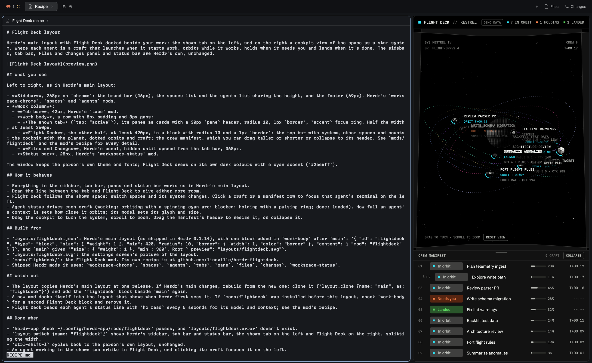

# Flight Deck layout

Herdr's main layout with Flight Deck docked beside your work: the shown tab on the left, and on the right a cockpit view of the space as a star system, where each agent is a craft that launches when it starts work, orbits while it works, holds when it needs you and lands when it's done. The sidebar, tab bar, Files and Changes panel and status bar are Herdr's own, unchanged.

## What you see

Left to right, as in Herdr's main layout:

- **Sidebar**, 268px on `chrome`: the brand bar (46px), the spaces list and the agents list sharing the height, and the footer (69px). Herdr's `workspace-chrome`, `spaces` and `agents` mods.
- **Work column**:
  - **Tab bar**, 42px, Herdr's `tabs` mod.
  - **Work body**, a row with 8px padding and 8px gaps:
    - **The shown tab** (`tab: "active"`), its panes as cards with a 30px `pane` header, radius 10, 1px `border`, `accent` focus ring. Half the width, at least 360px.
    - **Flight Deck**, the other half, at least 420px, in a block with radius 10 and a 1px `border`: the top bar with system, other spaces and counts; the cockpit with the planet, dotted orbits and craft; the crew manifest, which you can drag taller or shorter or collapse to its header. See `mods/flightdeck` and the mod's recipe for every detail.
    - **Files and Changes**, Herdr's panel, hidden until opened from the tab bar, 368px.
  - **Status bar**, 28px, Herdr's `workspace-status` mod.

The window keeps the person's own theme and fonts; Flight Deck draws on its own dark colours with a cyan accent (`#2ee6ff`).

## How it behaves

- Everything in the sidebar, tab bar, panes and status bar works as in Herdr's main layout.
- Drag the line between the tab and Flight Deck to give either more room.
- Flight Deck follows the shown space: switch spaces and its system changes. Click a craft or a manifest row to focus that agent's terminal on the left.
- Agent status drives each craft (working: orbiting with a spinning cyan arc; blocked: holding with a pulsing ring; done: landed). How full an agent's context is sets how close it orbits; its model sets its glyph and size.
- Drag the cockpit to turn the system, scroll to zoom. Drag the manifest's header to resize it, or collapse it.

## Built from

- `layouts/flightdeck.json`: Herdr's main layout (as shipped in Herdr 0.1.14), with one block added in `work-body` after `main`: `{ "id": "flightdeck", "type": "block", "size": { "weight": 1 }, "min": 420, "radius": 10, "border": { "width": 1, "color": "border" }, "content": { "mod": "flightdeck" } }`, and `main` given `"size": { "weight": 1 }, "min": 360`. Root `"preview": "layouts/flightdeck.svg"`.
- `layouts/flightdeck.svg`: the settings screen's picture of the layout.
- `mods/flightdeck/`: the Flight Deck mod. Its own recipe is at github.com/lineville/herdr-flightdeck.
- Shipped Herdr mods it uses: `workspace-chrome`, `spaces`, `agents`, `tabs`, `pane`, `files`, `changes`, `workspace-status`.

## Watch out

- The layout copies Herdr's main layout at one release. If Herdr's main changes, rebuild from the new one: clone it (`layout.clone {name: "main", as: "flightdeck"}`) and add the `flightdeck` block beside `main` again.
- A new mod docks itself into the layout that shows when Herdr first sees it. If `mods/flightdeck` was installed before this layout, check `work-body` for a second Flight Deck block and remove it.
- Flight Deck reads each agent's status line with `hc read` every 5 seconds for its model and context; see the mod's recipe.

## Done when

- `herdr-app check ~/.config/herdr-app/mods/flightdeck` passes, and `layouts/flightdeck.error` doesn't exist.
- `layout.switch {name: "flightdeck"}` shows Herdr's sidebar, tab bar and status bar, the shown tab on the left and Flight Deck on the right, splitting the width.
- `ctrl-shift-l` cycles back to the person's own layout, unchanged.
- An agent working in the shown tab orbits in Flight Deck, and clicking its craft focuses it on the left.
- Dragging the line between them resizes both.
